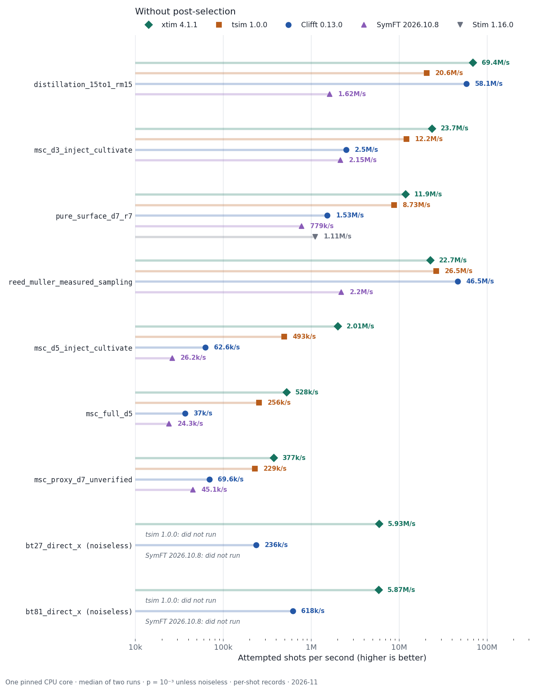
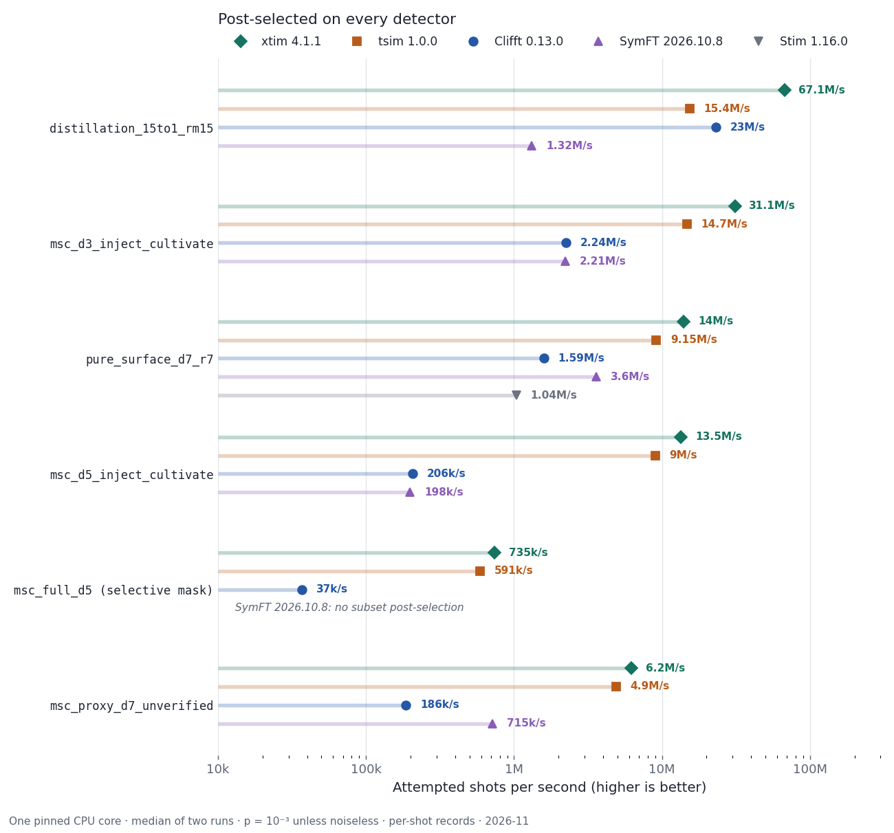
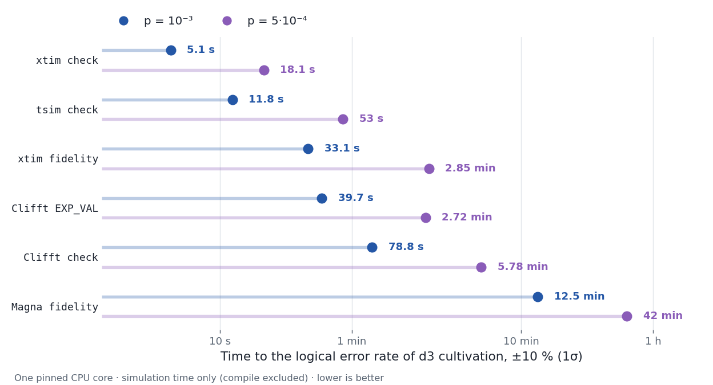

# Performance

Measurements of xtim 4.1.1 against other simulators of noisy circuits with non-Clifford gates, on public workloads.
All runs are single thread, on one pinned core of an otherwise idle Linux host (each run started at load < 2), with
the median of two runs reported. Measured 2026-11. The figures are regenerated by
[assets/make_performance_figures.py](assets/make_performance_figures.py). Each simulator ran in its default configuration unless noted.
In every comparison the simulators agree on acceptance (two-proportion |z| ≤ 2) and, where estimated, on the logical
error rate within error bars.

## How fast is xtim per shot?

<picture>
  <source media="(prefers-color-scheme: dark)" srcset="assets/throughput-unselected-dark.png">
  
</picture>

<picture>
  <source media="(prefers-color-scheme: dark)" srcset="assets/throughput-selected-dark.png">
  
</picture>

Workloads from [clifft-bench](https://github.com/unitaryfoundation/clifft-bench) at p = 10⁻³ (bt27 and bt81 are
noiseless there, so post-selection does not change them). Every tool returns each shot's detector and observable
bits, the same job for all; Clifft runs through its per-shot records call (`sample`, `sample_survivors(keep_records=True)`)
and Stim only on the Clifford-only surface code. The table gives nanoseconds (ns) per attempted shot, lower is
better; PS is the post-selection mask (none, or all detectors).

| workload | PS | xtim 4.1.1 | tsim 1.0.0 | Clifft 0.13.0 | SymFT 2026.10.8 | Stim 1.16.0 |
|---|---|---|---|---|---|---|
| distillation_15to1_rm15_p1e-3 | none | 14.4 | 48.5 | 17.2 | 619 | |
| distillation_15to1_rm15_p1e-3 | all | 14.9 | 65.1 | 43.4 | 759 | |
| msc_d3_inject_cultivate_p1e-3 | none | 42.2 | 82.2 | 400 | 465 | |
| msc_d3_inject_cultivate_p1e-3 | all | 32.2 | 67.9 | 447 | 452 | |
| pure_surface_d7_r7_p1e-3 | none | 84.0 | 114.5 | 656 | 1284 | 904 |
| pure_surface_d7_r7_p1e-3 | all | 71.3 | 109.3 | 628 | 277 | 963 |
| reed_muller_measured_sampling | none | 44.1 | 37.7 | 21.5 | 454 | |
| msc_d5_inject_cultivate_p1e-3 | none | 498 | 2028 | 15977 | 38108 | |
| msc_d5_inject_cultivate_p1e-3 | all | 74.3 | 111 | 4863 | 5050 | |
| msc_full_d5_p1e-3 | none | 1894 | 3900 | 27055 | 41160 | |
| msc_full_d5_p1e-3 | all (acceptance 0) | 1283 | 1637 | 25412 | 14763 | |
| msc_full_d5_p1e-3 | selective mask (acceptance 0.117) | 1360 | 1691 | 27053 | no subset post-selection | |
| msc_proxy_d7_unverified_p1e-3 | none | 2654 | 4362 | 14372 | 22151 | |
| msc_proxy_d7_unverified_p1e-3 | all | 161 | 204 | 5365 | 1399 | |
| bt27_direct_x (noiseless) | none | 169 | out of memory | 4232 | out of memory | |
| bt81_direct_x (noiseless) | none | 171 | needs 63 active qubits | 1618 | too many qubits | |

- Clifft also has a counts-only call (`sample_survivors(keep_records=False)`), which returns attempted, accepted
  and observable-flip totals without per-shot records; clifft-bench times every tool that way. On it Clifft takes
  1.6 ns/shot on distillation_15to1_rm15 and 11.4 ns/shot on reed_muller_measured_sampling, where its compiler
  removes the non-Clifford gates entirely. xtim has no counts-only call.
- With every detector post-selected, msc_full_d5 accepts no shot at p = 10⁻³ (every row times rejection only);
  clifft-bench post-selects it on a selective mask, shown as its own row and used in the post-selected figure.
- SymFT's post-selected rows use its counts call, as clifft-bench does; it has no per-shot post-selected call.
- All tools agree on acceptance and on the observable flip rate in every row (largest two-proportion |z| = 2.3).
- Not run: the clifft-bench workloads with arbitrary-angle rotations (`coherent_*`, the `R_X` distillation variant,
  the Draper adder, Quantum Volume), which xtim does not support.

### bt27 and bt81 with noise

clifft-bench runs bt27 and bt81 without noise. We added uniform circuit noise at p = 10⁻³ (`DEPOLARIZE1` after every
single-qubit gate, `DEPOLARIZE2` after every `CX` except classically controlled ones, a flip after every reset and
before every measurement); they then become much harder. Times are per attempted shot:

| workload | PS | xtim 4.1.1 | tsim 1.0.0 | Clifft 0.13.0 | Magna 0.2.0 |
|---|---|---|---|---|---|
| bt27_direct_x + noise | none | 30.6 µs | out of memory | no result in 20 min | |
| bt27_direct_x + noise | all (acceptance 0.041) | 0.21 µs | no result in 20 min | no result in 13 min | 19.8 µs |
| bt81_direct_x + noise | none | 252 µs | | | |

Magna estimates acceptance directly instead of returning per-shot records, so it has no row without post-selection.
With every detector post-selected, noisy bt81 accepts no shot at p = 10⁻³ (none in 10⁶ attempts), so that row is
not shown.

## How long does it take to get a logical error rate?

<picture>
  <source media="(prefers-color-scheme: dark)" srcset="assets/time-to-precision-dark.png">
  
</picture>

How long it takes to estimate the post-selected logical error rate ε of the clifft-bench d = 3 cultivation circuit
to ±10 % (1σ). This combines the cost per attempt, the acceptance, and how much each accepted shot tells you:
time = φ · (1 − ε) · c / (acceptance · 0.1² · ε), where φ is the per-shot variance relative to a pass/fail bit.

- **Check route:** the circuit ends with the noiseless inverse T layer and a logical readout; a flipped observable is
  a failure (φ = 1).
- **Exact per-shot fidelity:** xtim `RecordFidelity`, Clifft `EXP_VAL`, Magna's fidelity mode.

ε = 9.0 × 10⁻⁷ at p = 10⁻³ and 1.6 × 10⁻⁷ at p = 5 × 10⁻⁴; acceptance 0.687 and 0.829. Versions: xtim 4.1.1, tsim 1.0.0, Clifft 0.13.0,
Magna 0.2.0.

| route | time, p = 10⁻³ | time, p = 5·10⁻⁴ | cost per attempt (µs), 10⁻³ / 5·10⁻⁴ | φ, 10⁻³ / 5·10⁻⁴ |
|---|---|---|---|---|
| xtim check | 5.1 s | 18 s | 0.032 / 0.024 | 1 / 1 |
| tsim check | 11.8 s | 53 s | 0.073 / 0.071 | 1 / 1 |
| xtim fidelity | 33 s | 2.8 min | 0.29 / 0.35 | 0.70 / 0.66 |
| Clifft EXP_VAL | 40 s | 2.7 min | 0.35 / 0.34 | 0.69 / 0.65 |
| Clifft check | 79 s | 5.8 min | 0.49 / 0.47 | 1 / 1 |
| Magna fidelity | 12.5 min | 42 min | 11.7 / 12.0 | 0.40 / 0.28 |

Magna returns no per-shot values; its φ is derived from its reported standard error. Exact per-shot fidelity lowers
the variance by about 1.5× here, less than the extra cost per shot, so the check route is the faster way to the
answer whenever a noiseless check exists.

## How fast is exact output fidelity?

xtim's bundled examples (`xtim.list_examples()`), translated for [Magna](https://github.com/itpyi/magna) 0.2.0.
µs per attempted shot in steady state; "acceptance" samples and post-selects only, "fidelity" also scores each
accepted shot's output state exactly.

| circuit | mode | xtim 4.1.0 (µs/shot) | Magna 0.2.0 (µs/shot) |
|---|---|---|---|
| distillation_15_1_3 | acceptance | 0.014 | 7.24 |
| distillation_15_1_3 | fidelity | 0.29 | 12.0 |
| cultivation_d3_faithful | acceptance | 0.039 | 7.41 |
| cultivation_d3_faithful | fidelity | 0.39 | 11.8 |
| cultivation_d5 | acceptance | 0.79 | 12.0 |
| cultivation_d5 | fidelity | 4.1 | 19.4 |
| color5_cultivation | acceptance | 1.49 | 12.1 |
| color5_cultivation | fidelity | 6.7 | 19.0 |
| ch_cultivation | fidelity | 0.25 | 11.5 |
| cube_ccz (p = 10⁻³) | fidelity | 0.26 | 11.4 |
| code_switching_faithful | fidelity | 0.42 | 12.1 |

Compile time is 3-80 ms for xtim and 2-75 ms for Magna on these circuits.
