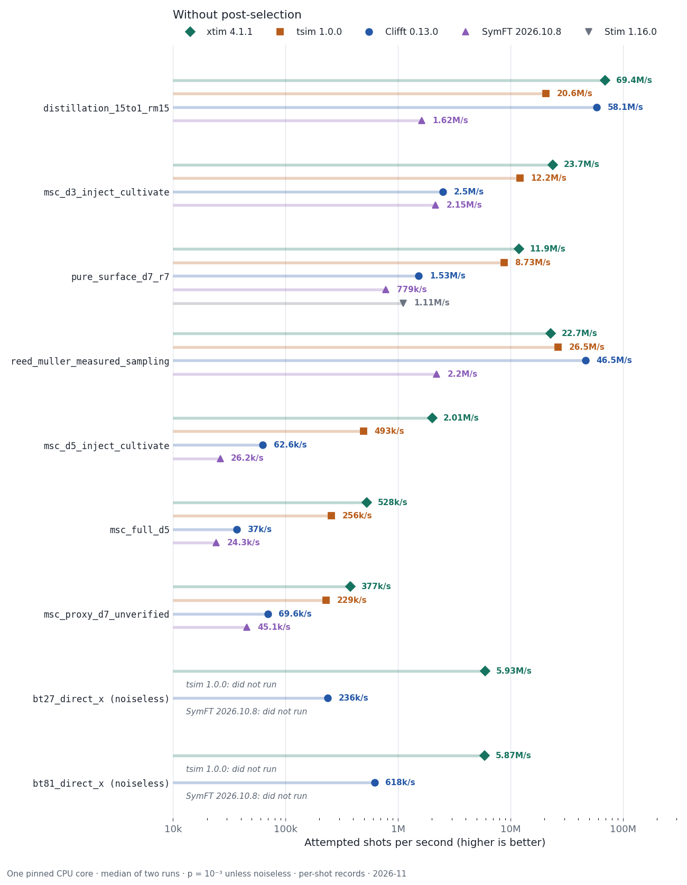
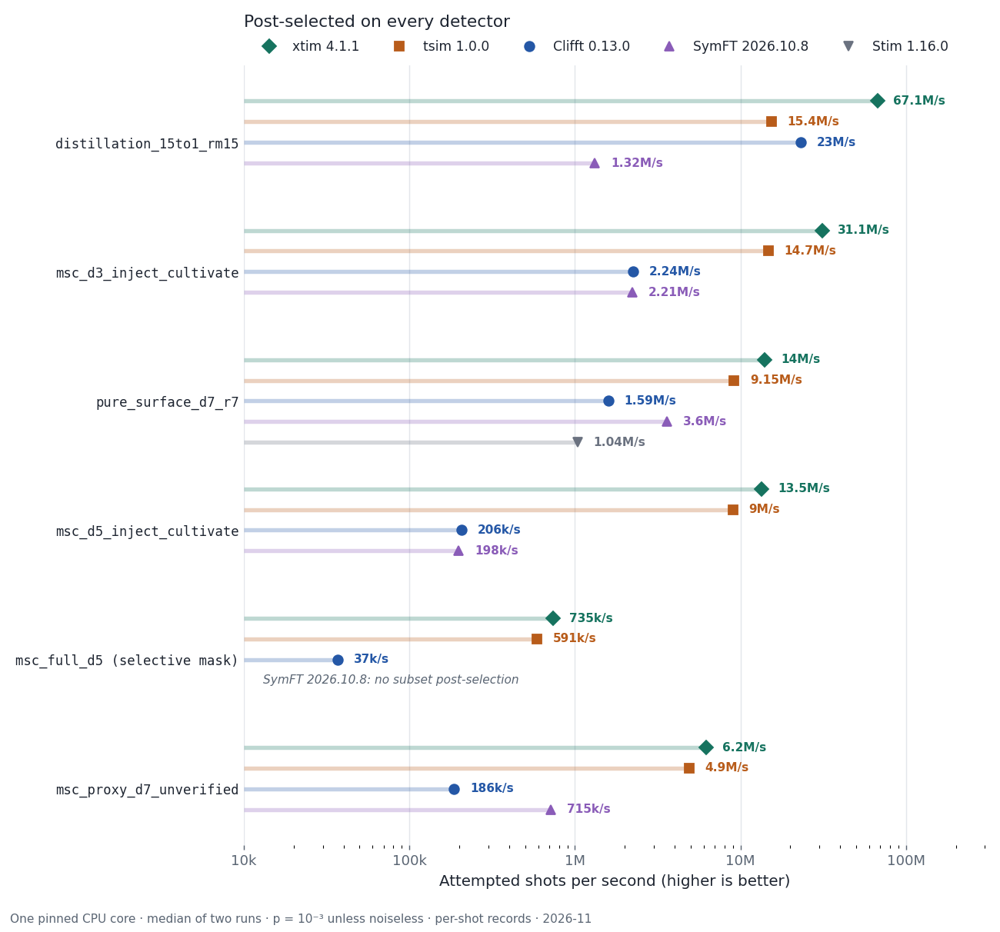
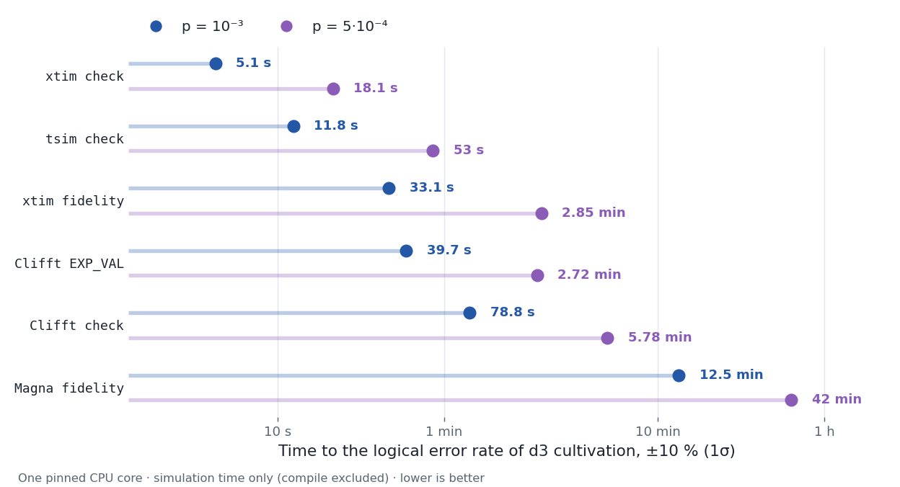

# Performance

Measurements of xtim 4.1.1 against other simulators of noisy circuits with non-Clifford gates, on public workloads.
All runs are single thread, on one pinned core of an otherwise idle Linux host (each run started at load < 2), with
the median of two runs reported. Measured 2026-11. The figures are regenerated by
[assets/make_performance_figures.py](assets/make_performance_figures.py). Each simulator ran in its default configuration unless noted.
In every comparison the simulators agree on acceptance (two-proportion |z| ≤ 2) and, where estimated, on the logical
error rate within error bars.

## How fast is xtim per shot?

<picture>
  <source media="(prefers-color-scheme: dark)" srcset="assets/throughput-unselected-dark.png">
  
</picture>

<picture>
  <source media="(prefers-color-scheme: dark)" srcset="assets/throughput-selected-dark.png">
  
</picture>

Workloads from [clifft-bench](https://github.com/unitaryfoundation/clifft-bench) at p = 10⁻³ (bt27 and bt81 are
noiseless there, so post-selection does not change them). Every tool returns each shot's detector and observable
bits, the same job for all; Clifft runs through its per-shot records call (`sample`, `sample_survivors(keep_records=True)`)
and Stim only on the Clifford-only surface code. The table gives nanoseconds (ns) per attempted shot, lower is
better; PS is the post-selection mask (none, or all detectors).

| workload | PS | xtim 4.1.1 | tsim 1.0.0 | Clifft 0.13.0 | SymFT 2026.10.8 | Stim 1.16.0 |
|---|---|---|---|---|---|---|
| distillation_15to1_rm15_p1e-3 | none | 14.4 | 48.5 | 17.2 | 619 | |
| distillation_15to1_rm15_p1e-3 | all | 14.9 | 65.1 | 43.4 | 759 | |
| msc_d3_inject_cultivate_p1e-3 | none | 42.2 | 82.2 | 400 | 465 | |
| msc_d3_inject_cultivate_p1e-3 | all | 32.2 | 67.9 | 447 | 452 | |
| pure_surface_d7_r7_p1e-3 | none | 84.0 | 114.5 | 656 | 1284 | 904 |
| pure_surface_d7_r7_p1e-3 | all | 71.3 | 109.3 | 628 | 277 | 963 |
| reed_muller_measured_sampling | none | 44.1 | 37.7 | 21.5 | 454 | |
| msc_d5_inject_cultivate_p1e-3 | none | 498 | 2028 | 15977 | 38108 | |
| msc_d5_inject_cultivate_p1e-3 | all | 74.3 | 111 | 4863 | 5050 | |
| msc_full_d5_p1e-3 | none | 1894 | 3900 | 27055 | 41160 | |
| msc_full_d5_p1e-3 | all (acceptance 0) | 1283 | 1637 | 25412 | 14763 | |
| msc_full_d5_p1e-3 | selective mask (acceptance 0.117) | 1360 | 1691 | 27053 | no subset post-selection | |
| msc_proxy_d7_unverified_p1e-3 | none | 2654 | 4362 | 14372 | 22151 | |
| msc_proxy_d7_unverified_p1e-3 | all | 161 | 204 | 5365 | 1399 | |
| bt27_direct_x (noiseless) | none | 169 | out of memory | 4232 | out of memory | |
| bt81_direct_x (noiseless) | none | 171 | needs 63 active qubits | 1618 | too many qubits | |

- Clifft also has a counts-only call (`sample_survivors(keep_records=False)`), which returns attempted, accepted
  and observable-flip totals without per-shot records; clifft-bench times every tool that way. On it Clifft takes
  1.6 ns/shot on distillation_15to1_rm15 and 11.4 ns/shot on reed_muller_measured_sampling, where its compiler
  removes the non-Clifford gates entirely. xtim has no counts-only call.
- With every detector post-selected, msc_full_d5 accepts no shot at p = 10⁻³ (every row times rejection only);
  clifft-bench post-selects it on a selective mask, shown as its own row and used in the post-selected figure.
- SymFT's post-selected rows use its counts call, as clifft-bench does; it has no per-shot post-selected call.
- All tools agree on acceptance and on the observable flip rate in every row (largest two-proportion |z| = 2.3).
- Not run: the clifft-bench workloads with arbitrary-angle rotations (`coherent_*`, the `R_X` distillation variant,
  the Draper adder, Quantum Volume), which xtim does not support.

### bt27 and bt81 with noise

clifft-bench runs bt27 and bt81 without noise. We added uniform circuit noise at p = 10⁻³ (`DEPOLARIZE1` after every
single-qubit gate, `DEPOLARIZE2` after every `CX` except classically controlled ones, a flip after every reset and
before every measurement); they then become much harder. Times are per attempted shot:

| workload | PS | xtim 4.1.1 | tsim 1.0.0 | Clifft 0.13.0 | Magna 0.2.0 |
|---|---|---|---|---|---|
| bt27_direct_x + noise | none | 30.6 µs | out of memory | no result in 20 min | |
| bt27_direct_x + noise | all (acceptance 0.041) | 0.21 µs | no result in 20 min | no result in 13 min | 19.8 µs |
| bt81_direct_x + noise | none | 252 µs | | | |

Magna estimates acceptance directly instead of returning per-shot records, so it has no row without post-selection.
With every detector post-selected, noisy bt81 accepts no shot at p = 10⁻³ (none in 10⁶ attempts), so that row is
not shown.

## How long does it take to get a logical error rate?

<picture>
  <source media="(prefers-color-scheme: dark)" srcset="assets/time-to-precision-dark.png">
  
</picture>

How long it takes to estimate the post-selected logical error rate ε of the clifft-bench d = 3 cultivation circuit
to ±10 % (1σ). This combines the cost per attempt, the acceptance, and how much each accepted shot tells you:
time = φ · (1 − ε) · c / (acceptance · 0.1² · ε), where φ is the per-shot variance relative to a pass/fail bit.

- **Check route:** the circuit ends with the noiseless inverse T layer and a logical readout; a flipped observable is
  a failure (φ = 1).
- **Exact per-shot fidelity:** xtim `RecordFidelity`, Clifft `EXP_VAL`, Magna's fidelity mode.

ε = 9.0 × 10⁻⁷ at p = 10⁻³ and 1.6 × 10⁻⁷ at p = 5 × 10⁻⁴; acceptance 0.687 and 0.829. Versions: xtim 4.1.1, tsim 1.0.0, Clifft 0.13.0,
Magna 0.2.0.

| route | time, p = 10⁻³ | time, p = 5·10⁻⁴ | cost per attempt (µs), 10⁻³ / 5·10⁻⁴ | φ, 10⁻³ / 5·10⁻⁴ |
|---|---|---|---|---|
| xtim check | 5.1 s | 18 s | 0.032 / 0.024 | 1 / 1 |
| tsim check | 11.8 s | 53 s | 0.073 / 0.071 | 1 / 1 |
| xtim fidelity | 33 s | 2.8 min | 0.29 / 0.35 | 0.70 / 0.66 |
| Clifft EXP_VAL | 40 s | 2.7 min | 0.35 / 0.34 | 0.69 / 0.65 |
| Clifft check | 79 s | 5.8 min | 0.49 / 0.47 | 1 / 1 |
| Magna fidelity | 12.5 min | 42 min | 11.7 / 12.0 | 0.40 / 0.28 |

Magna returns no per-shot values; its φ is derived from its reported standard error. Exact per-shot fidelity lowers
the variance by about 1.5× here, less than the extra cost per shot, so the check route is the faster way to the
answer whenever a noiseless check exists.

## How fast is exact output fidelity?

xtim's bundled examples (`xtim.list_examples()`), translated for [Magna](https://github.com/itpyi/magna) 0.2.0.
µs per attempted shot in steady state; "acceptance" samples and post-selects only, "fidelity" also scores each
accepted shot's output state exactly.

| circuit | mode | xtim 4.1.0 (µs/shot) | Magna 0.2.0 (µs/shot) |
|---|---|---|---|
| distillation_15_1_3 | acceptance | 0.014 | 7.24 |
| distillation_15_1_3 | fidelity | 0.29 | 12.0 |
| cultivation_d3_faithful | acceptance | 0.039 | 7.41 |
| cultivation_d3_faithful | fidelity | 0.39 | 11.8 |
| cultivation_d5 | acceptance | 0.79 | 12.0 |
| cultivation_d5 | fidelity | 4.1 | 19.4 |
| color5_cultivation | acceptance | 1.49 | 12.1 |
| color5_cultivation | fidelity | 6.7 | 19.0 |
| ch_cultivation | fidelity | 0.25 | 11.5 |
| cube_ccz (p = 10⁻³) | fidelity | 0.26 | 11.4 |
| code_switching_faithful | fidelity | 0.42 | 12.1 |

Compile time is 3-80 ms for xtim and 2-75 ms for Magna on these circuits.

## How fast is the GPU sampler?

`XdemSampler(text, device="gpu")` against the CPU sampler on the same xdem files ([the GPU section of the xdem
route](xdem.md#11-gpu-sampling)). Every number is in the committed report
[assets/gpu/metal-m3max.json](assets/gpu/metal-m3max.json), written by `python tools/gpu_validate.py` (full mode, every
section passed: 181 device tests, 148 kernel cases and 96 entry-point cases byte-equal to the C++ reference build, the
stress cases, the benchmark) on an **Apple M3 Max** (Metal; macOS 26.3.1, 30.2 GB of unified memory shared with the
CPU, 14 CPU threads, Python 3.13.13, numpy 2.5.5, a 4.2.0 development build, commit 4e99299 of the development history,
run on 2026-11-25). The report replaces an earlier development build's: since then the walk kernel became a group kernel over segments of chains, structured laws
were added (one-word and multi-word), `sample` writes its outputs on the device, and `sample(status=False)` exists.
This table is one Apple machine: it says nothing about other Apple chips. The CUDA backend is reported
[below](#on-an-nvidia-gpu-quadro-rtx-6000-cuda). The runs are one measurement per cell (not a
median of repeats, unlike the other tables on this page), and the CPU cells moved by tens of percent between two
complete runs of the tool on the same machine (for example `cultivation_d5` `sample` at all threads: 23.8, 55.9 and
39.0 million shots/s in three runs; the first two are not committed), so ratios that differ by less than a factor of
about 1.5 are not established.

Rates are millions of attempted shots per second (`shots / wall time` of the whole call, including everything the
host does, with the one-time kernel compile and table upload excluded: 8 to 45 ms per sampler here). The GPU ran
50 000 000 shots per cell, fewer for the `sample` rows of the files whose returned rows are large (28 256 363 on
`cultivation_d5`, 29 826 161 on `color5_cultivation`, 48 806 446 on `bh_like36`, 35 791 394 on `bh_like70`: the returned
arrays are kept under 512 MB), the CPU 10 000 000. The CPU is measured two ways:

- "call": the same call on the CPU sampler, `threads=14` ("all") and `threads=1` ("1").
- "sample+score", for the two `infidelity` rows only: what a user can do instead on the CPU, `sample(...,
  postselect=...)` followed by `score(status, zeros)`, in chunks of 2^20 shots, at all threads and at one. This is
  the stronger CPU baseline in most rows (not in `color5_cultivation` `infidelity`, where the two are within 2%).

The last two columns are GPU / CPU call all (the report's `speedup_vs_cpu_all`) and GPU / best CPU, the fastest of
the row's CPU numbers (`speedup_vs_best_cpu`); the second is the ratio to quote.

The first three files are bundled examples (`examples/xdem/`). `bh_like36` and `bh_like70` are **generated**
Bravyi-Haah-like files (`bh_like_text` of `tests/_xdem_synth.py`, 300 lines, 36 and 70 observables), not the
external `merlin_bh*` circuits ([below](#benchmark-files-not-in-this-repository)): they have the same shape (the
structured law accepts them: one-word for `bh_like36`, multi-word for `bh_like70`, the report's `law_path`), but their
numbers are not those of the `merlin_bh*` files.

| file | call | GPU | CPU call all | CPU call 1 | CPU sample+score all | CPU sample+score 1 | GPU / CPU call all | GPU / best CPU |
|---|---|---|---|---|---|---|---|---|
| `cultivation_d3_faithful` | `sample` | 457.1 | 318.5 | 36.5 | – | – | 1.44 | 1.44 |
| `cultivation_d3_faithful` | `sample_nostatus` | 535.9 | 310.4 | 36.8 | – | – | 1.73 | 1.73 |
| `cultivation_d3_faithful` | `sample_ps_all` | 363.6 | 402.5 | 61.7 | – | – | 0.90 | 0.90 |
| `cultivation_d3_faithful` | `infidelity` | 623.0 | 122.6 | 32.8 | 167.4 | 33.5 | 5.08 | 3.72 |
| `cultivation_d3_faithful` | `infidelity_ps_all` | 706.9 | 156.9 | 53.4 | 226.6 | 55.1 | 4.51 | 3.12 |
| `cultivation_d5` | `sample` | 135.4 | 39.0 | 4.8 | – | – | 3.47 | 3.47 |
| `cultivation_d5` | `sample_nostatus` | 147.2 | 50.7 | 4.9 | – | – | 2.91 | 2.91 |
| `cultivation_d5` | `sample_ps_all` | 220.4 | 185.8 | 18.9 | – | – | 1.19 | 1.19 |
| `cultivation_d5` | `infidelity` | 302.0 | 40.2 | 4.8 | 45.0 | 4.9 | 7.51 | 6.71 |
| `cultivation_d5` | `infidelity_ps_all` | 442.5 | 131.3 | 18.8 | 154.3 | 18.6 | 3.37 | 2.87 |
| `color5_cultivation` | `sample` | 129.2 | 51.1 | 4.8 | – | – | 2.53 | 2.53 |
| `color5_cultivation` | `sample_nostatus` | 161.2 | 48.1 | 4.8 | – | – | 3.35 | 3.35 |
| `color5_cultivation` | `sample_ps_all` | 223.2 | 174.1 | 17.8 | – | – | 1.28 | 1.28 |
| `color5_cultivation` | `infidelity` | 253.2 | 40.2 | 4.8 | 39.5 | 4.7 | 6.30 | 6.30 |
| `color5_cultivation` | `infidelity_ps_all` | 424.0 | 117.8 | 16.6 | 134.7 | 18.5 | 3.60 | 3.15 |
| `bh_like36` | `sample` | 0.1 | 2.6 | 0.4 | – | – | 0.04 | 0.04 |
| `bh_like36` | `sample_nostatus` | 18.8 | 2.2 | 0.6 | – | – | 8.62 | 8.62 |
| `bh_like36` | `sample_ps_all` | 4.9 | 12.4 | 2.7 | – | – | 0.39 | 0.39 |
| `bh_like36` | `infidelity` | 16.3 | 2.6 | 0.5 | 1.7 | 0.4 | 6.40 | 6.40 |
| `bh_like36` | `infidelity_ps_all` | 57.7 | 16.7 | 2.3 | 20.5 | 2.5 | 3.47 | 2.81 |
| `bh_like70` | `sample` | 0.1 | 1.9 | 0.3 | – | – | 0.03 | 0.03 |
| `bh_like70` | `sample_nostatus` | 7.8 | 1.8 | 0.3 | – | – | 4.45 | 4.45 |
| `bh_like70` | `sample_ps_all` | 1.2 | 5.5 | 1.0 | – | – | 0.22 | 0.22 |
| `bh_like70` | `infidelity` | 9.5 | 1.5 | 0.3 | 1.3 | 0.2 | 6.28 | 6.28 |
| `bh_like70` | `infidelity_ps_all` | 13.9 | 6.6 | 0.9 | 8.1 | 0.9 | 2.11 | 1.72 |

The calls: `sample` is `sample(shots, seed=...)` returning every row; `sample_nostatus` is `sample(shots, seed=...,
status=False)` (detectors and observables only); `sample_ps_all` is `sample` with `postselect=` on every detector,
returning the survivors; `infidelity` is `infidelity(shots, None, seed=...)`, the zero decoder; `infidelity_ps_all` is
that with `postselect=` on every detector.

What the table shows:

- **The device-only estimate is where the GPU wins most: 1.72 to 6.71 times the best CPU** (`infidelity(shots,
  None)`, with or without post-selection, runs entirely on the device and returns only counters). Against the
  stronger CPU baseline (sample + score on all 14 threads) the two calls give 3.72 and 3.12 times on
  `cultivation_d3_faithful`, 6.71 and 2.87 on `cultivation_d5`, 6.30 and 3.15 on `color5_cultivation`, 6.40 and 2.81
  on `bh_like36`, 6.28 and 1.72 on `bh_like70`. Limit: no rows or flags cross to the host, so this is the zero decoder
  only.
- **`sample()` returning rows is 1.44, 3.47 and 2.53 times the all-thread CPU on the three bundled files, and far
  slower on the generated Bravyi-Haah-like files** (0.04 and 0.03 times). Limit, on those files: most shots carry a C
  that the device's table of C does not hold, and the host looks those up one by one. `sample(status=False)` skips
  the C key and the C id and returns the same rows: 1.73, 2.91 and 3.35 times on the bundled files and 8.62 and 4.45
  times on `bh_like36` and `bh_like70` (166 and 119 times the same file's default `sample` rate). It is the call to
  use when you decode the observables yourself and need no `score`.
- **`sample(postselect=...)` on every detector is 0.90 to 1.28 times the all-thread CPU on the bundled files and
  0.39 and 0.22 times on the generated ones** (the same lookup of C ids). The CPU discards a shot that cannot satisfy
  the mask before it does any gauge-qubit work, which is why a mask on every detector is its best case. We did not
  profile this further.
- One CPU thread is far slower than 14 in every row, so a GPU / CPU ratio depends on how many CPU cores you have.
  To compare on your own machine, run `python tools/gpu_validate.py`.

The same report's `stress` section: one sampler shared by six threads gives every call (including
`sample(status=False)`) its single-threaded result (180 calls); a file firing about 510 extended lines per shot
samples byte-equal to the reference at a pair capacity of 1 044 481 records per block at its first sample, and, from a
capacity of 2^16 on blocks of 2^10 shots, after 3 forced relaunches at 524 288; a DEM firing 4000 lines per shot runs
in submissions of 192 000 shots taking 0.36 to 0.70 s each.

### On an NVIDIA GPU: Quadro RTX 6000 (CUDA)

The CUDA backend has since been run once on NVIDIA hardware, with the same tool in full mode on a Lambda on-demand cloud
instance: a **Quadro RTX 6000** (Turing, compute capability 7.5, 24 GB), driver 580.196.07 (CUDA 13.0), CuPy 14.2.0
(`cupy-cuda13x`), Ubuntu 22.04, 14 vCPUs, Python 3.13.18, numpy 2.5.5, a 4.2.0 development build, run on 2026-11-25.
The kernels it ran are those of this release (the walk already a group kernel). The report is
[assets/gpu/cuda-rtx6000.json](assets/gpu/cuda-rtx6000.json) and it says `RESULT: PASS`: the 42 CUDA-marked tests
passed (no failure, no skip), 148 of 148 kernel cases (all eight kernels) and 96 of 96 entry-point cases were
byte-equal to the C++ reference build, the 3 stress cases passed, and the 25 benchmark measurements ran. The report's
`git_commit` is 92c4627 (of the development history) with `git_dirty: true`. The one difference from that commit was
a fix to the tests, committed afterwards (`tests/test_gpu_cuda.py`: the capability table `CAPS1` lacked `XK_CAP_SHM`, which NVRTC rejects
as fatal; it was the only failure of the first CUDA test run), plus untracked log files. This is one card, one driver
and one CuPy version: it says nothing about other NVIDIA GPUs.

The table is built from the report in the same way as the one above: millions of attempted shots per second, the GPU
at the shot counts in the report (50 000 000, and 28 256 363, 29 826 161, 48 806 446 and 35 791 394 for the `sample`
rows of `cultivation_d5`, `color5_cultivation`, `bh_like36` and `bh_like70`), the CPU 10 000 000.

| file | call | GPU | CPU call all | CPU call 1 | CPU sample+score all | CPU sample+score 1 | GPU / CPU call all | GPU / best CPU |
|---|---|---|---|---|---|---|---|---|
| `cultivation_d3_faithful` | `sample` | 284.0 | 132.2 | 24.1 | – | – | 2.15 | 2.15 |
| `cultivation_d3_faithful` | `sample_nostatus` | 486.3 | 127.3 | 24.5 | – | – | 3.82 | 3.82 |
| `cultivation_d3_faithful` | `sample_ps_all` | 256.0 | 154.5 | 36.1 | – | – | 1.66 | 1.66 |
| `cultivation_d3_faithful` | `infidelity` | 1648.0 | 25.6 | 21.1 | 82.6 | 21.5 | 64.37 | 19.95 |
| `cultivation_d3_faithful` | `infidelity_ps_all` | 2198.9 | 28.0 | 29.6 | 104.4 | 32.2 | 78.43 | 21.05 |
| `cultivation_d5` | `sample` | 109.9 | 35.2 | 3.3 | – | – | 3.12 | 3.12 |
| `cultivation_d5` | `sample_nostatus` | 132.7 | 34.3 | 3.3 | – | – | 3.87 | 3.87 |
| `cultivation_d5` | `sample_ps_all` | 350.9 | 75.7 | 9.9 | – | – | 4.64 | 4.64 |
| `cultivation_d5` | `infidelity` | 437.3 | 10.9 | 3.2 | 25.3 | 3.2 | 40.08 | 17.31 |
| `cultivation_d5` | `infidelity_ps_all` | 945.8 | 23.5 | 9.7 | 76.9 | 9.8 | 40.31 | 12.30 |
| `color5_cultivation` | `sample` | 117.1 | 36.3 | 3.3 | – | – | 3.23 | 3.23 |
| `color5_cultivation` | `sample_nostatus` | 141.6 | 36.4 | 3.3 | – | – | 3.89 | 3.89 |
| `color5_cultivation` | `sample_ps_all` | 376.9 | 75.8 | 9.9 | – | – | 4.97 | 4.97 |
| `color5_cultivation` | `infidelity` | 490.1 | 11.2 | 3.2 | 29.4 | 3.3 | 43.68 | 16.68 |
| `color5_cultivation` | `infidelity_ps_all` | 1180.8 | 24.7 | 9.8 | 64.5 | 9.9 | 47.75 | 18.30 |
| `bh_like36` | `sample` | 0.1 | 2.4 | 0.3 | – | – | 0.05 | 0.05 |
| `bh_like36` | `sample_nostatus` | 107.8 | 2.6 | 0.5 | – | – | 41.86 | 41.86 |
| `bh_like36` | `sample_ps_all` | 4.5 | 18.1 | 1.9 | – | – | 0.25 | 0.25 |
| `bh_like36` | `infidelity` | 127.5 | 1.4 | 0.4 | 1.4 | 0.4 | 93.81 | 91.41 |
| `bh_like36` | `infidelity_ps_all` | 331.6 | 9.0 | 1.8 | 10.7 | 1.8 | 36.68 | 31.07 |
| `bh_like70` | `sample` | 0.1 | 1.7 | 0.2 | – | – | 0.06 | 0.06 |
| `bh_like70` | `sample_nostatus` | 46.7 | 1.7 | 0.2 | – | – | 27.43 | 27.43 |
| `bh_like70` | `sample_ps_all` | 1.4 | 7.7 | 0.8 | – | – | 0.18 | 0.18 |
| `bh_like70` | `infidelity` | 55.6 | 0.8 | 0.2 | 1.1 | 0.2 | 69.85 | 50.17 |
| `bh_like70` | `infidelity_ps_all` | 84.9 | 5.0 | 0.7 | 4.1 | 0.7 | 16.84 | 16.84 |

The calls are those of the table above. Two caveats. The CPU here is much weaker than the M3 Max's: the same 14 CPU
threads reach 132.2 million shots/s on `cultivation_d3_faithful` `sample` against 318.5 on the Mac, and the
all-thread `infidelity` cells are barely above their one-thread cells (25.6 against 21.1 on `cultivation_d3_faithful`).
The GPU / CPU ratios of this table are against that weak CPU, and **must not be compared with the Mac's ratios**; they
say what this GPU does against this instance's CPU, not how a Quadro RTX 6000 compares with an M3 Max. And, as above,
each cell is a single measurement, so ratios within a factor of about 1.5 are not established. The pattern is the same
as on the Mac: the device-only estimate is the fastest call, `sample(status=False)` is far faster than the default
`sample` on the generated Bravyi-Haah-like files (0.1 against 107.8 million shots/s on `bh_like36`), and the default
`sample` and the post-selected `sample` on those files are slower than the CPU (0.05 and 0.25 times on `bh_like36`).

### Against tsim on an NVIDIA machine

`tools/gpu_compare.py --skip xtim-cpu --tsim-python <tsim environment> --shots 4194304 --reps 5 --limit 60` on the same
instance (xtim on the Quadro RTX 6000; tsim 1.1.0), on `cultivation_d3_faithful` and `cultivation_d5` (bundled),
`magna_rp2-d5` and the `merlin_bh12`, `merlin_bh36`, `merlin_bh50` and `merlin_bh70` files with depolarizing noise at
p = 10⁻³ (external benchmark files, not in this repository: see
[below](#benchmark-files-not-in-this-repository)). Every row is in
[assets/gpu/compare-tsim-rtx6000.jsonl](assets/gpu/compare-tsim-rtx6000.jsonl). The numbers are **ns per attempted
shot**, the median of 5 calls of 4 194 304 shots (lower is better); "post-selection on" is a mask on every detector,
"accept" is the fraction of shots accepted. xtim's `sample` returns the rows and the status, `nostatus` is
`sample(status=False)` (detectors and observables only), and `estimate` is the device-only `infidelity(shots, None)`;
the last column divides tsim's time by `nostatus`'s, because tsim returns only detectors and observables.

| circuit | post-selection | accept | xtim `sample` | xtim `nostatus` | xtim `estimate` | tsim 1.1.0 (CPU) | tsim / xtim `nostatus` |
|---|---|---|---|---|---|---|---|
| `cultivation_d3_faithful` | off | 1 | 3.4 | 1.4 | 0.5 | 41.8 | 29.4 |
| `cultivation_d3_faithful` | on | 0.687 | 3.0 | 1.7 | 0.4 | 34.9 | 20.8 |
| `cultivation_d5` | off | 1 | 9.8 | 8.1 | 2.1 | 721 | 89.4 |
| `cultivation_d5` | on | 0.144 | 2.5 | 2.1 | 1.2 | 26.5 | 12.6 |
| `magna_rp2-d5` | off | 1 | 12.8 | 10.3 | 3.2 | 12 329 | 1193.9 |
| `magna_rp2-d5` | on | 0.0944 | 3.1 | 2.8 | 2.1 | 33.6 | 12.0 |
| `merlin_bh12_dep_p1e-3` | off | 1 | 57.5 | 2.7 | 1.6 | 126 | 45.8 |
| `merlin_bh12_dep_p1e-3` | on | 0.365 | 19.4 | 1.4 | 0.7 | 34.3 | 23.7 |
| `merlin_bh36_dep_p1e-3` | off | 1 | 2 347 | 13.7 | 5.7 | 1 677 | 122.5 |
| `merlin_bh36_dep_p1e-3` | on | 0.0334 | 58.3 | 2.2 | 1.8 | 32.7 | 14.9 |
| `merlin_bh50_dep_p1e-3` | off | 1 | 5 525 | 18.5 | 8.9 | 2 742 | 148.6 |
| `merlin_bh50_dep_p1e-3` | on | 0.00588 | 97.9 | 2.7 | 2.4 | 38.1 | 13.9 |
| `merlin_bh70_dep_p1e-3` | off | 1 | 12 964 | 33.7 | 20.4 | 4 105 | 122.0 |
| `merlin_bh70_dep_p1e-3` | on | 0.000461 | 238 | 9.3 | 5.0 | 52.0 | 5.6 |

**This is not GPU against GPU.** The tool labels tsim's rows `tsim-gpu`, but tsim 1.1.0's default strategy
(`active_statevector`) has GPU kernels only for Apple Metal; on Linux it runs on the CPU (the rows' `device` field is
`cpu`), here on all 14 vCPUs of the instance, a weak CPU. The table compares xtim on the NVIDIA GPU with tsim on that
machine's CPU. On the M3 Max, tsim's own Metal kernels were on par with xtim and faster on post-selected
Bravyi-Haah files; nothing of the kind has been measured on NVIDIA hardware, so the ratios in the last column are not a
statement about tsim on a GPU. In the table, xtim's default `sample` is slower than tsim on `merlin_bh36` (2 347 against
1 677 ns per shot), `merlin_bh50` and `merlin_bh70` without post-selection, the case the Mac table also shows (most
shots carry a C that the device's table does not hold); `nostatus` is not. Timings of tsim's first call (compilation of
its kernels) are in the file as `first_call_s`: 19.5 s on `cultivation_d3_faithful` and 50.5 s on `magna_rp2-d5`
without post-selection; the table does not include them.

Measured by hand and not in the file: tsim's `cat5` stabilizer-rank strategy does run on the NVIDIA GPU (JAX 0.12.1,
`bloqade-tsim[cuda13]`). On `cultivation_d3_faithful` it took 59 610 ns per shot without post-selection and 40 342 with
post-selection on every detector (2^20 shots, one call, after a first call of 83 to 87 s and a compile of about 4 s);
on `merlin_bh12` it had not finished one call after 10 minutes and was stopped. These are single calls, not medians.

## How fast are compile and DEM export on large circuits?

`compile_detector_sampler` and `detector_error_model_text` on two Clifford families, before the sparse-compile changes
(a development build after 4.1.2) and after. Seconds of work (circuit parsing excluded) and peak memory, one fresh process
per cell pinned to one core, median of 3 runs under 60 s; 40 GB address-space limit. Measured 2026-11.

| circuit | measurements | bare state, before / after | compile, before / after | DEM export, before / after |
|---|---|---|---|---|
| R/X_ERROR/M/DETECTOR chain, N = 4000 | 4000 | 4.3 s / 0.29 s | 5.7 s (0.8 GB) / 0.45 s (0.4 GB) | 5.0 s / 0.29 s |
| chain, N = 8000 | 8000 | 24.2 s / 1.0 s | 32.3 s (3.1 GB) / 1.56 s (1.4 GB) | 29.1 s / 0.98 s |
| chain, N = 16000 | 16000 | 116 s / 3.9 s | 152 s (12.2 GB) / 5.7 s (5.6 GB) | 179 s / 3.6 s |
| chain, N = 32000 | 32000 | out of memory / 14.5 s | out of memory / 22.0 s (22 GB) | out of memory / 13.5 s |
| rotated surface code memory, d = 11, 11 rounds | 1441 | 0.25 s / 0.05 s | 0.37 s / 0.16 s | 4.1 s (288 MB) / 0.17 s (90 MB) |
| surface code, d = 15, 15 rounds | 3585 | 1.5 s / 0.21 s | 2.3 s / 0.77 s | 36.8 s (1.4 GB) / 0.58 s (196 MB) |
| surface code, d = 21, 21 rounds | 9681 | 17.2 s / 1.3 s | 26.4 s (2.4 GB) / 5.4 s (1.5 GB) | 505 s (9.8 GB) / 2.6 s (0.9 GB) |
| surface code, d = 25, 25 rounds | 16225 | – / 3.0 s | – / 14.6 s (3.5 GB) | – / 5.7 s (2.2 GB) |

The surface codes are stim's `surface_code:rotated_memory_z` at p = 10⁻³. Time and memory still grow about
quadratically in the measurement count (each doubling costs about 3.6x in time and 3.9x in memory on the chain),
because the frame tableau is still dense at that point (the Stage-2 numbers and gates are in "How much memory do compile and DEM export need on large circuits?" below).
The 64000-measurement chain needs more than 40 GB.

The magic-circuit examples: compile and the two exports in milliseconds, before / after, median of 3 interleaved
pinned runs (each a median of 3 calls). Outputs are identical byte for byte; per-shot sampling speed is unchanged.

| circuit | compile | DEM export (`format="stim"`) | xdem export |
|---|---|---|---|
| cultivation_d5 | 54.6 / 39.5 | 195 / 161 | 44.1 / 42.3 |
| color5_cultivation | 56.1 / 38.5 | 251 / 164 | 40.8 / 39.8 |
| cultivation_d3_faithful | 4.4 / 3.9 | 13.7 / 11.9 | 5.0 / 5.0 |
| code_switching_faithful | 3.9 / 3.5 | refused | refused |
| code_switching_rate | 3.7 / 2.9 | refused | refused |
| xdem/code_switching_faithful_noobs | 3.8 / 3.3 | 9.4 / 6.7 | 5.2 / 4.5 |
| xdem/code_switching_rate_noobs | 3.2 / 2.8 | 6.3 / 3.7 | 4.0 / 3.5 |
| xdem/distillation_15_1_3_gatenoise | 1.4 / 1.2 | 2.3 / 2.0 | 1.3 / 1.3 |
| xdem/rm15rep | 1.3 / 1.2 | 1.3 / 1.2 | 1.2 / 1.2 |
| distillation_15_1_3 | 0.8 / 0.7 | 0.5 / 0.4 | 0.9 / 0.9 |
| ch_cultivation | 0.8 / 0.7 | 0.3 / 0.3 | 0.4 / 0.4 |
| miniature_oracle | 0.6 / 0.5 | 0.5 / 0.5 | 0.5 / 0.5 |
| cube_ccz, xdem/ccz_toy, ccz_toy_obs, ex422_obs, tdag_cycle, toy2obs | 0.2-0.6, unchanged | 0.1-0.5, unchanged | 0.1-0.7, unchanged |

The smallest DEM exports (about 0.1 ms) are 2-4% slower (3-7 µs per export), the fixed cost of the sparse fault
table.

### Magic DEM export (lean route)

`detector_error_model_text(format="xdem")` on large circuits with T gates, measured on a 4.2.0 development build.
Seconds of CPU time for the export alone (circuit parsing excluded) and peak resident memory of the
process, median of 3 fresh processes pinned to one core, BLAS threads 1. The last column is the growth per doubling of
the size (for the surface code, of the measurement count) for time / memory; a value above 2.3x is marked `>`.

| circuit | size | time | peak memory | per doubling, time / memory |
|---|---|---|---|---|
| surface + T (no rotating fault) | d = 15 / 21 / 25 | 0.57 / 1.88 / 3.56 s | 112 / 240 / 416 MB | 2.31x`>` , 2.35x`>` / 1.70x, 2.09x |
| surface + noisy T | d = 15 / 21 / 25 | 0.21 / 0.62 / 1.09 s | 105 / 209 / 327 MB | 2.17x, 2.12x / 1.61x, 1.82x |
| chain + T | N = 8k / 16k / 32k / 64k | 0.21 / 0.43 / 0.87 / 1.78 s | 85 / 130 / 221 / 394 MB | 2.0x / 1.5x - 1.8x |
| chain + noisy T | N = 8k / 16k / 32k / 64k | 0.16 / 0.32 / 0.64 / 1.27 s | 83 / 129 / 220 / 394 MB | 2.0x / 1.6x - 1.8x |
| GHZ + noisy T | N = 8k / 16k / 32k | 0.11 / 0.22 / 0.45 s | 80 / 118 / 197 MB | 2.0x / 1.5x - 1.7x |
| GHZ, H T H | N = 8k / 16k / 32k | 0.20 / 0.52 / 1.47 s | 80 / 118 / 197 MB | 2.64x`>` , 2.82x`>` / 1.5x - 1.7x |
| repetition code + 2 noisy T | d = 1000 / 2100 / 4200 | 0.060 / 0.123 / 0.254 s | 64 / 88 / 131 MB | 1.95x, 2.06x / 1.35x, 1.49x |
| one T per wire | N = 2k / 4k / 8k | 0.13 / 0.43 / 1.70 s | 72 / 145 / 425 MB | 3.38x`>` , 3.99x`>` / 2.02x, 2.93x`>` |
| reference: Clifford surface code, `format="stim"` | d = 15 / 21 / 25 | 0.42 / 1.44 / 2.79 s | 113 / 242 / 407 MB | 2.36x`>` , 2.43x`>` / 1.71x, 2.01x |

The noisy-T families (a rotating fault before the T) run on the sparse lean route and grow linearly. The noiseless
surface + T and the GHZ H T H circuits take the no-rotation path and grow like the stim-format export (the surface
row sits at the 2.3x line, as the Clifford reference does). One T per wire is the one family that grows
super-linearly; it is the known weak case. The gates are `tests/test_xdem_scaling.py` (slow).

## How much memory do compile and DEM export need on large circuits?

Peak memory and time of `compile_detector_sampler`, compile plus a first `sample(1000)`, and `detector_error_model_text`
on the large Clifford circuits, measured on a 4.2.0 development build (all the sparse-frame changes). One fresh process
per cell pinned to one core; seconds of the operation (circuit parsing excluded); peak RSS of the whole process (about
40-300 MB of it is the interpreter, the extension and the circuit text: the 100000 chain's text alone is about 290 MB);
40 GB address-space limit. Rows from N = 100000 and d = 21 on: `benchmarks/compile_dem_acceptance.py --repeat 3`, wall
time, median of 3 processes. Chain rows up to 64000: `tests/test_compile_scaling.py`, CPU time, min of 5 processes
(on a pinned core the two agree within a few per cent).

| circuit | measurements | compile | compile + sample(1000) | DEM export |
|---|---|---|---|---|
| R/X_ERROR/M/DETECTOR chain, N = 16000 | 16000 | 0.33 s (128 MB) | 0.35 s (138 MB) | 0.19 s (92 MB) |
| chain, N = 32000 | 32000 | 0.81 s (188 MB) | 0.83 s (257 MB) | 0.39 s (157 MB) |
| chain, N = 64000 | 64000 | 2.2 s (305 MB) | 2.3 s (383 MB) | 0.82 s (262 MB) |
| chain, N = 100000 | 100000 | 4.75 s (442 MB) | 4.88 s (559 MB) | 1.46 s (394 MB) |
| `REPEAT 100000 { X_ERROR(0.01) 0 / M 0 / DETECTOR rec[-1] / R 0 }` | 100000 | 3.10 s (395 MB) | – | 1.00 s (379 MB) |
| rotated surface code memory, d = 21, 21 rounds | 9681 | 1.78 s (255 MB) | 1.78 s (255 MB) | 1.45 s (237 MB) |
| surface code, d = 25, 25 rounds | 16225 | 4.84 s (408 MB) | 4.87 s (408 MB) | 2.78 s (402 MB) |
| surface code, d = 29, 29 rounds | 25201 | 11.0 s (595 MB) | 10.8 s (594 MB) | 4.94 s (562 MB) |

The chain 100000 compile has a 4.71-5.20 s spread over six runs on two cores (median 4.74 s).

Against the previous development build (before the sparse-frame changes), end to end: compile and then the first
`sample(1000)` in one process, or one DEM export; one pinned core, wall time, median of 3 fresh processes; peak RSS in
MiB. "Did not fit": the previous build's process ran out of the 40 GB address space building the dense bare state. This is a different harness from
the table above (its own worker script), so its times and peaks differ from that table's by up to about 5%.

| circuit | compile | peak, compile + first sample(1000) | DEM export |
|---|---|---|---|
| surface code, d = 21, 21 rounds | 5.2 -> 1.76 s | 1502 -> 260 MiB | 2.56 -> 1.45 s (911 -> 242 MiB) |
| surface code, d = 25, 25 rounds | 14.7 -> 4.8 s | 3763 -> 413 MiB | 5.52 -> 2.78 s (2295 -> 408 MiB) |
| chain, N = 16000 | 5.5 -> 0.33 s | 6359 -> 144 MiB | 3.64 -> 0.19 s (3961 -> 98 MiB) |
| chain, N = 32000 | 30 -> 0.81 s | 25.1 GB -> 262 MiB | 19.6 -> 0.39 s (15.6 GB -> 156 MiB) |
| chain, N = 64000 | did not fit -> 2.2 s | did not fit -> 385 MiB | did not fit -> 0.83 s (267 MiB) |
| chain, N = 100000 | did not fit -> 4.7 s | did not fit -> 564 MiB | did not fit -> 1.45 s (399 MiB) |

The first `sample(1000)` adds tens of milliseconds and little memory to the compile. Peak memory grows 1.1x-1.9x per
doubling of the chain from 1000 to 64000 for all three operations, and 1.3x-1.7x per doubling of the deferred wires on
the surface code (d = 11, 15, 21). Time grows near-linearly up to the chain at 16000 (2.1x-2.2x per doubling; the DEM
export 2.1x per doubling all the way to 64000), then faster: the compile 2.4x per doubling from 16000 to 32000 and
2.7x from 32000 to 64000, and on the surface code d = 15 -> 21 2.6x per doubling for the compile and 2.4x for the DEM
export. This fits the word-parallel term (measurements x wires / 64) that the compile and export still have, which is
quadratic and so overtakes the linear part on large circuits (not profiled).
`tests/test_compile_scaling.py` gates every doubling at 2.3x in time and in peak memory (memory: chain 1000 to 64000,
surface d = 11, 15, 21; time: chain 4000 to 64000, surface d = 15, 21); the time steps above the bound are listed in
that file with their measured ratios.

## Benchmark files not in this repository

Some measurements on this page and in the CHANGELOG use circuits that this repository does not ship, so they cannot
be reproduced from the repository alone:

- `merlin_bh12`, `merlin_bh36`, `merlin_bh50`, `merlin_bh70`, `merlin_bh100` (`merlin_bh*_dep_p1e-3`): Bravyi-Haah
  distillation circuits with depolarizing noise at p = 10⁻³, from the Merlin benchmark set
  ([arXiv:2610.06811](https://arxiv.org/abs/2610.06811), [merlin-sim](https://github.com/mark-koch/merlin-sim)).
- `bt27`, `bt81` (p = 10⁻³ or 10⁻⁴) and `magna_rp2-d5`: external benchmark files, not in this repository.

The tests that use the `merlin_bh*` files read them from `$XTIM_MERLIN_CIRCUITS` and skip when it is unset.
